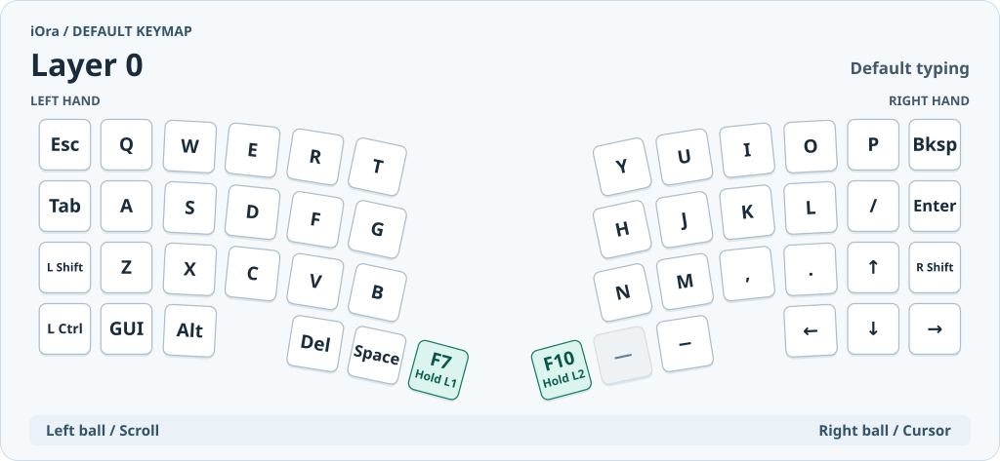
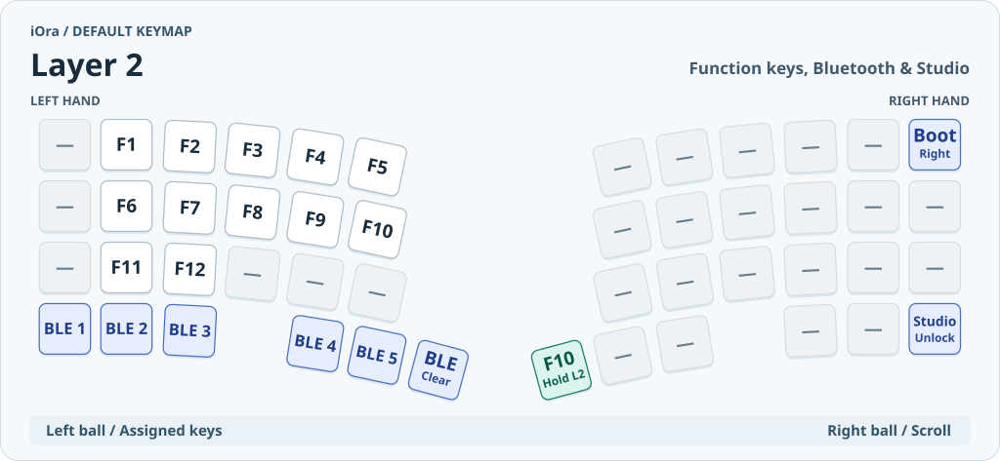
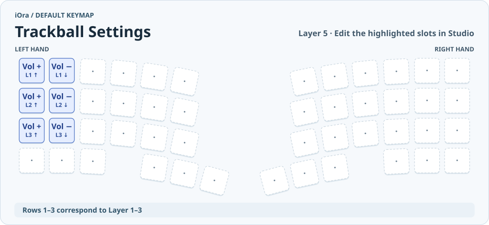

# iOra ユーザーガイド

iOraは左右にトラックボールを備えた48キーの分割キーボードです。左手側がPCとUSBまたはBluetoothでつながり、右手側は左手側とBluetoothでつながります。

- [全レイヤーの配置と同時押しの図](iOra-keymap-cheatsheet.md)
- [Bluetoothの接続と切り替え](#bluetooth)
- [ZMK Studioでキーを変更する](#zmk-studioでキーを変更する)
- [設定ファイルで動作を変更する](#設定ファイルで動作を変更する)
- [ファームウェアを書き込む](#ファームウェアを書き込む)

## Bluetooth

1. 両側の電源を入れます。Bluetoothで使うときは、左手側からUSBケーブルを抜きます。
2. 右手の **F10／L2** を長押ししながら、左手最下段の **BLE 1〜5** のいずれかを押して接続枠を選びます。
3. PCのBluetooth設定で **iOra** を選びます。次のPCは未使用の枠に登録し、以降は同じキー操作で切り替えます。

選択中の枠だけを消去するには、**F10／L2** を長押ししながら **BLE Clear** の位置を押します。そのPCへつなぎ直す場合は、PC側のBluetooth設定からも既存のiOraを削除して再ペアリングします。[ZMKのBluetooth操作](https://v0-3-branch.zmk.dev/docs/keymaps/behaviors/bluetooth)

## ZMK Studioでキーを変更する

普段使うキーやレイヤー上の割り当ては、ZMK Studioから変更できます。WindowsでBluetooth接続する場合はデスクトップ版を使います。USB接続なら左手側をPCにつなぎ、Chrome／EdgeでWeb版も使えます。[ZMK Studioの使い方](https://v0-3-branch.zmk.dev/docs/features/studio)・[Web版](https://zmk.studio/)・[デスクトップ版](https://zmk.studio/download)

1. ZMK Studioで **iOra** を選んで接続します。
2. **F10／L2** を長押ししながら、右手の右下にある **Studio Unlock**（通常は右矢印）を押します。位置は上のLayer 2の図で確認できます。
3. 変更したいレイヤーとキーを選び、割り当てを変更して **Save** を押します。オートマウスの切り替えキーを移すときは **Auto Mouse Toggle** を選びます。

Studioで保存したキーやレイヤー名は、通常のFW更新後も優先されます。**Restore Stock Settings** を使うとStudioで保存した変更を消去し、書き込んだFWのキーマップに戻せます。[ZMKの設定保存](https://zmk.dev/docs/config/settings)

### トラックボールの左右を切り替える

**F7／L1を長押ししながら、左下の左Ctrlの右隣**（通常はGUIキー）を1回押します。押すたびに左右の役割が入れ替わり、電源を入れ直しても最後の設定を使います。Studioでは **Trackball Swap** を好きなキーに割り当てられます。[切り替えキーの図](docs/images/layer-1.svg)

### トラックボールにキーを割り当てる

1. Studioで **Trackball Settings**（L5）を開きます。
2. L1は最上段、L2は2段目、L3は3段目の左端2枠を編集します。左端が上方向、その右隣が下方向です。**Key Press** から好きなキーコードを選びます。初期値はどの段も音量アップ・ダウンです。
3. **Save** を押します。L1・L2・L3でキー入力を担当するボールを転がすと、そのレイヤーに対応するキーが入力されます。初期状態は左ボールで、左右を入れ替えると右ボールです。無効にしたい方向は **None** にします。複数が有効なときは、優先順位が最も高いレイヤーの設定を使います。

## 設定ファイルで動作を変更する

コンボの追加やタイミング、トラックボールの感度などは設定ファイルで変更し、FWを再ビルドします。

| 変更したいこと | 編集する場所 | 変更方法 |
| --- | --- | --- |
| キーやレイヤー名 | [config/iora.keymap](config/iora.keymap) | 対象レイヤーの `bindings` または `display-name` を編集します。各行は左手6キー、右手6キーの順です。 |
| 同時押し（コンボ） | [config/iora.keymap](config/iora.keymap) | `combos` の `key-positions`、`bindings`、`layers`、`timeout-ms` を編集します。位置番号は左上を0とし、各段を左から右へ12個ずつ数えます。 |
| オートマウスのON/OFFキー | [config/iora.keymap](config/iora.keymap) | `&auto_mouse_toggle` を移します。初期位置はL1の左下（通常は左Ctrl）です。切り替えた状態は左手側に保存されます。 |
| トラックボールの左右切り替えキー | [config/iora.keymap](config/iora.keymap) | `&trackball_swap` を移します。初期位置はL1の左下から2番目（通常はGUIキー）です。 |
| オートマウスの解除時間・入力直後の待機時間 | [iora_left.overlay](boards/shields/iora/iora_left.overlay) | `processor = <&zip_temp_layer 4 800>` の最後が解除までの時間、`require-prior-idle-ms = <200>` がキー入力直後の待機時間です。単位はmsです。 |
| ボールのキー入力の感度・連続入力間隔 | [iora_left.overlay](boards/shields/iora/iora_left.overlay) | `counts-per-tap = <48>` を小さくすると短い移動で反応します。`repeat-interval-ms = <40>` は連続入力の最短間隔です。 |
| スクロールの速さ | [iora_left.overlay](boards/shields/iora/iora_left.overlay) | `auxiliary-scroll` は通常時のスクロール、`primary-scroll` はL1〜3のスクロールの設定です。各 `zip_xy_scaler 1 16` の分母を小さくすると速くなります。 |
| トラックボールのセンサー感度 | [iora.dtsi](boards/shields/iora/iora.dtsi) | `cpi = <800>` を変更します。左右共通の設定なので、変更後は両側のFWを書き込みます。 |
| ディープスリープまでの時間 | [config/iora.conf](config/iora.conf) | `CONFIG_ZMK_IDLE_SLEEP_TIMEOUT` を変更します。iOraの初期値は3,600,000 ms（1時間）です。変更後は両側のFWを書き込みます。 |

たとえばミュートを割り当てるなら、対象のキーを `&kp C_MUTE` に置き換えます。`&none` は入力なし、`&trans` は下の有効なレイヤーの割り当てを使います。オートマウスのクリック位置を変更する場合は、L4の割り当てとコンボに加えて、`iora_left.overlay` の `excluded-positions` も合わせます。[ZMKキーコード一覧](https://v0-3-branch.zmk.dev/docs/keymaps/list-of-keycodes)・[ZMKコンボの設定](https://zmk.dev/docs/keymaps/combos)

### GitHub Actionsで再ビルドする

1. このリポジトリをGitHubでフォークします。フォークの **Actions** でワークフローを有効にします。
2. 設定を編集してコミットをプッシュします。または **Actions → Build ZMK firmware → Run workflow** で、編集したブランチを選びます。
3. 成功した実行の **Artifacts** から `firmware` をダウンロードし、ZIPを展開します。`iOra_L.uf2` が左手用、`iOra_R.uf2` が右手用です。[ZMKのビルドと書き込み手順](https://v0-3-branch.zmk.dev/docs/user-setup)

## ファームウェアを書き込む

1. 初期FWを使う場合は、リポジトリの [左手用UF2](iOra_L-zmk.uf2) または [右手用UF2](iOra_R-zmk.uf2) を用意します。
2. 書き込む側をUSBでPCにつなぎ、ブートローダーに入れます。左側は **F7／L1を長押し＋左上のEscの位置**、右側は **F10／L2を長押し＋右上のBkspの位置**です。右側をキー操作で起動する場合は、左右が接続されている状態で行います。キー操作が使えない場合は、対象側のXIAOのリセットボタンを2回続けて押します。
3. 表示されたUSBドライブに対応するUF2をコピーします。両側の更新が必要な場合は片側ずつ行います。

キー配置・コンボ・オートマウス設定の変更なら左側の更新で反映されます。通常のUF2で上書きした場合は、ペアリング、Studioで保存したキーマップ、オートマウスのON/OFF、ボールの左右設定が残ります。[ブートローダーキーの図](iOra-keymap-cheatsheet.md)・[ZMKの設定保存](https://zmk.dev/docs/config/settings)
