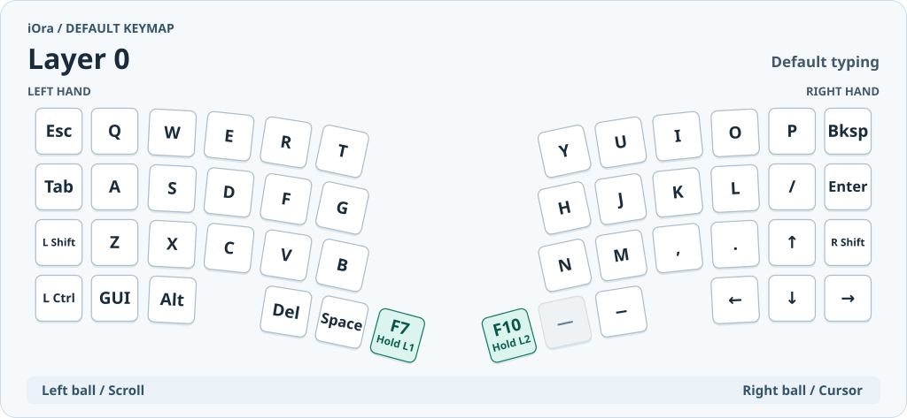
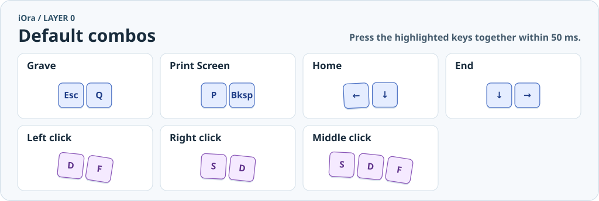
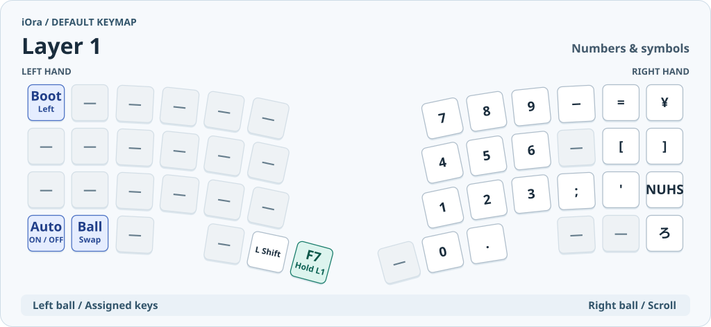
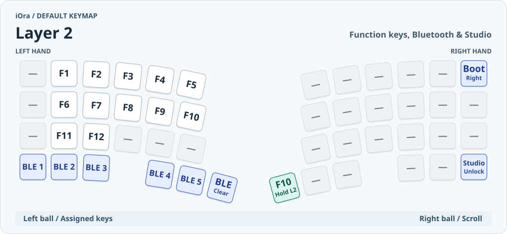
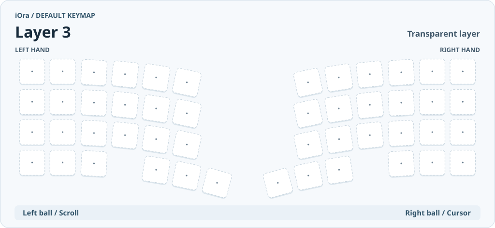
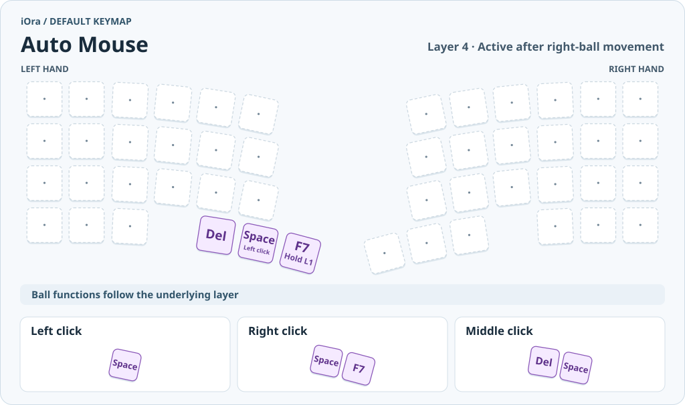
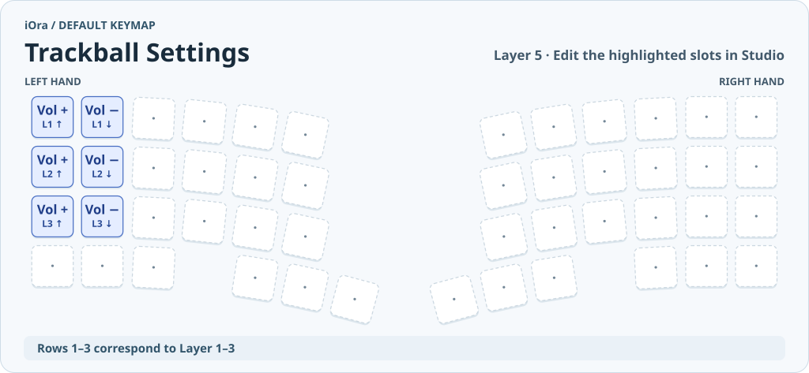

# iOra キーマップ早見表

初期ファームウェアの配置です。図は左右のキーを上から見た向きです。接続方法や割り当ての変更方法は [ユーザーガイド](README.md) を参照してください。

図中の **Hold L1** と **Hold L2** は、長押ししている間に使うレイヤーです。**—** は割り当てなし、**·** は下のレイヤーのキーをそのまま使う位置です。

## Layer 0 — 通常入力

最下段の内側にある **F7** と **F10** は、短く押すとそれぞれのFキーを入力し、約200 ms長押しするとL1・L2に切り替わります。離すと戻ります。**GUI** はWindowsキー／Commandキーです。

### Layer 0の同時押し

図のキーを50 ms以内に押します。Layer 0のクリックは、組み合わせに使ったキーをすべて離すまで保持されます。

## Layer 1 — 数字と記号

- **Boot Left** は左手側のブートローダーです。F7を長押ししながら、左上のEscの位置を押します。
- **Auto ON / OFF** はオートマウスの切り替えです。F7を長押ししながら、左下の左Ctrlの位置を押します。
- **¥** と **ろ** はJIS向け、**NUHS** は `NON_US_HASH` です。記号の出方はPC側の配列設定に従います。

## Layer 2 — Fキー・Bluetooth・Studio

| 操作 | F10を長押ししながら押す位置 |
| --- | --- |
| Bluetoothの接続枠を選ぶ | 左最下段の **BLE 1〜5** |
| 選択中の接続枠を消す | 左最下段の内側にある **BLE Clear** |
| ZMK Studioのロックを解除する | 右下の **Studio Unlock**（通常は右矢印） |
| 右手側をブートローダーに入れる | 右上の **Boot Right**（通常はBksp） |

## Layer 3 — 透過

初期状態では専用の呼び出しキーがありません。Studioで自分用のキーを割り当てて使えます。L3が有効な間は、左ボールでL5に設定したキーを入力し、右ボールで縦・横スクロールします。

## Layer 4 — Auto Mouse

右ボールを動かすとL4が有効になります。通常はカーソル移動、L1・L2・L3ではスクロールの操作で発動します。キー入力直後の200 msは発動を待ち、右ボールを止めてから800 msで解除されます。クリックに使わないキーを押したときも解除され、押したキーは通常どおり入力されます。

| 操作 | 押し方 |
| --- | --- |
| 左クリック | Space単独 |
| 右クリック | Space＋F7 |
| 中クリック | Del＋Space |

同時押しの判定は50 msです。右・中クリックは2キーを押している間ドラッグでき、どちらかを離すと終了します。F7単独の長押しではL1に切り替わり、右ボールでスクロールできます。

オートマウスは初回ONです。**F7を長押し＋左Ctrlの位置**で切り替えた状態は、電源を入れ直しても引き継がれます。

## Layer 5 — Trackball Settings

Studioで最上段の左端2枠を編集するとL1、2段目ならL2、3段目ならL3での左ボールの操作を変更できます。各段の左端が上方向、右隣が下方向です。[割り当ての変更手順](README.md#左トラックボールにキーを割り当てる)

## トラックボール

| 有効なレイヤー | 左手側 | 右手側 |
| --- | --- | --- |
| 通常 | 縦・横スクロール | カーソル移動 |
| L1・L2・L3のいずれか | 上下でキー入力（初期値は音量） | 縦・横スクロール |
